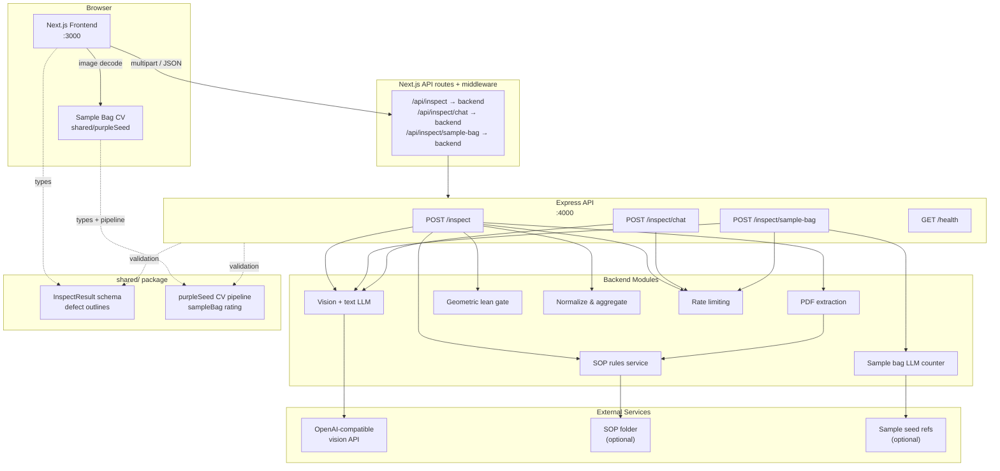
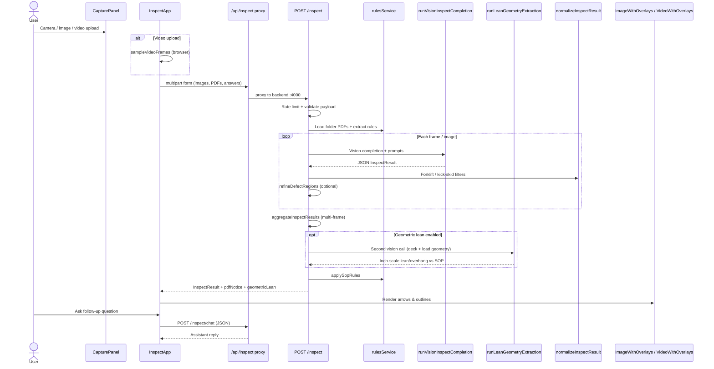
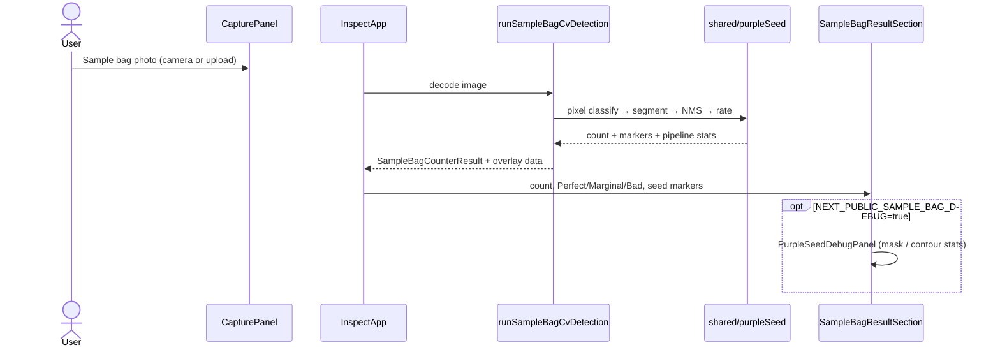
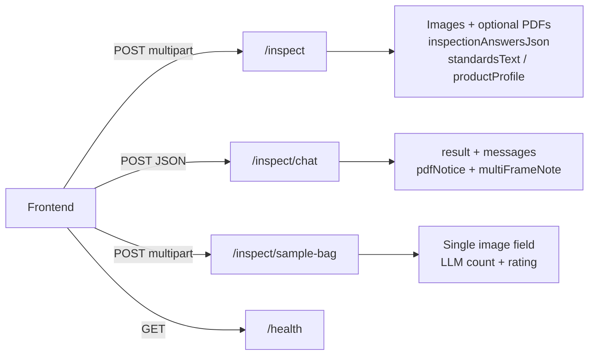
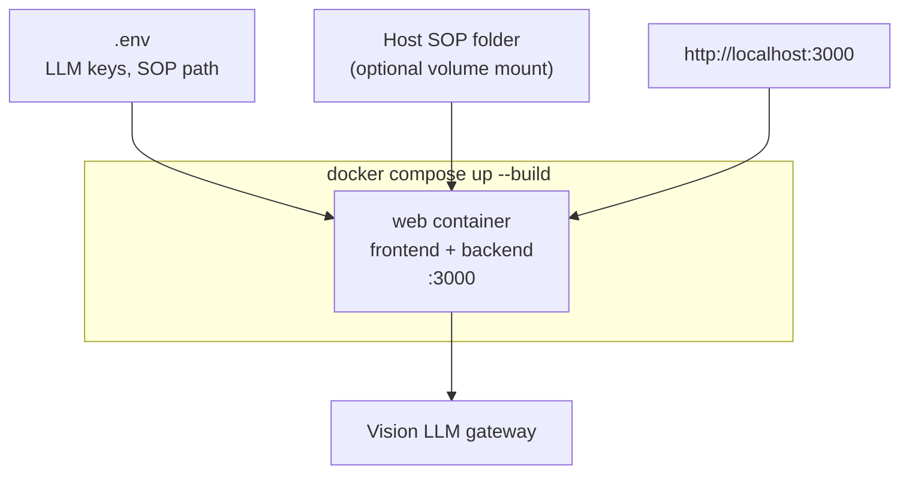

# Conformance Inspection

## Overview

This project is a monorepo for AI-driven product inspection and conformance checks. A Next.js frontend handles capture, preview, and defect overlays; an Express backend orchestrates vision LLM calls, PDF/SOP rule extraction, and deterministic result normalization.

The app is designed to:

- accept camera captures, uploaded images, and uploaded videos
- call a vision-enabled LLM for pallet/product inspection
- normalize and filter defects deterministically
- apply SOP rules from folder or uploaded PDF text
- run an optional geometric lean/overhang check against SOP Appearance limits
- render pass/fail results with highlighted issue overlays
- support follow-up chat about inspection results
- count purple seeds in clear sample bags (browser CV) and rate Perfect / Marginal / Bad

---

## System Architecture



### Monorepo layout

```
conformance-inspection/
├── frontend/          # Next.js UI (React 19)
├── backend/           # Express API server
├── shared/            # Shared schemas, sample-bag rating, purple-seed CV
├── scripts/           # Utility scripts (SOP sync, purple-seed calibration)
├── docker-compose.yml
└── Dockerfile
```

| Package   | Role | Port (local dev) |
|-----------|------|------------------|
| `frontend` | Capture UI, overlays, chat panel, browser sample-bag CV | 3000 |
| `backend`  | Inspection pipeline, LLM, SOP/PDF, geometric lean, LLM sample-bag API | 4000 |
| `shared`   | Schemas, purple-seed detection, sample-bag rating rules | — |

---

## Inspection Flow



### Sample bag flow (browser CV)

The **Sample Bag** tab runs entirely in the browser — no image is sent to the backend for counting.



A separate **LLM-based** counter is also available at `POST /inspect/sample-bag` (proxied via `/api/inspect/sample-bag`) for API clients or future UI paths. It supports optional few-shot reference images from `SAMPLE_SEED_REFERENCE_DIRECTORY`.

### Data path (ASCII)

```
┌─────────────┐   capture / upload    ┌──────────────────┐
│   Browser   │ ────────────────────► │  InspectApp.tsx  │
│  (camera)   │                       │  CapturePanel    │
└─────────────┘                       └────────┬─────────┘
                                               │
                    ┌──────────────────────────┼──────────────────────────┐
                    │ inspection tab           │ sample bag tab           │
                    ▼                          ▼                          │
         ┌──────────────────────┐    ┌─────────────────────┐              │
         │  /api/inspect proxy  │    │ shared/purpleSeed   │              │
         └──────────┬───────────┘    │ (browser CV only)   │              │
                    │                └─────────────────────┘              │
       ┌────────────┼────────────┬──────────────┐                         │
       ▼            ▼            ▼              ▼                         │
┌─────────────┐ ┌─────────┐ ┌─────────┐ ┌──────────────┐                 │
│ PDF extract │ │ SOP     │ │ Vision  │ │ Geometric    │                 │
│ extractText │ │ rules   │ │ LLM     │ │ lean gate    │                 │
└──────┬──────┘ └────┬────┘ └────┬────┘ └──────┬───────┘                 │
       └─────────────┴───────────┴─────────────┘                         │
                            ▼                                             │
                   ┌─────────────────┐                                    │
                   │ Normalize +     │                                    │
                   │ aggregate       │                                    │
                   │ (shared schema) │                                    │
                   └────────┬────────┘                                    │
                            ▼                                             │
                   ┌─────────────────┐                                    │
                   │ Overlays + chat │◄───────────────────────────────────┘
                   └─────────────────┘
```

---

## Component Map

### Frontend (`frontend/`)

| Module | Responsibility |
|--------|----------------|
| `components/InspectApp.tsx` | Main page: tabs, capture state, API calls, result rendering |
| `components/CapturePanel.tsx` | Inspection vs Sample Bag tabs; camera, image/video upload |
| `components/ImageWithOverlays.tsx` | Defect arrows and outlines on static images |
| `components/VideoWithOverlays.tsx` | Video playback with interpolated issue arrows |
| `components/SampleBagResultSection.tsx` | Purple seed count, rating, and overlay summary |
| `components/ImageWithPurpleSeedOverlays.tsx` | Seed marker rendering on sample bag photos |
| `components/PurpleSeedDebugPanel.tsx` | Optional mask/contour debug (when debug env is set) |
| `components/InspectionChatPanel.tsx` | Follow-up chat and result summary |
| `app/api/inspect/*` | Server-side proxy routes to Express backend |
| `lib/backendApi.ts` | Resolves `/api/*` proxy or direct backend origin |
| `lib/backendProxy.ts` | Forwards multipart/JSON to backend with auth headers |
| `lib/browser/runSampleBagCvDetection.ts` | Browser entry point for purple-seed counting |
| `lib/browser/detectPurpleKernelOutlines.ts` | Canvas image → analysis frame for CV pipeline |
| `lib/browser/sampleVideoFrames.ts` | Client-side video frame sampling |
| `lib/inspectionQuestions.ts` | Checklist questions sent with inspection |
| `middleware.ts` | Injects `BACKEND_API_KEY` on proxied `/api/inspect*` requests |

### Backend (`backend/src/`)

| Module | Responsibility |
|--------|----------------|
| `routes/inspect/route.ts` | Multipart ingest, LLM pipeline, SOP checks, geometric lean |
| `routes/inspect/sampleBagRoute.ts` | LLM-based sample bag counter (optional API path) |
| `routes/inspect/chat/route.ts` | Text completion for inspection Q&A |
| `prompts/inspect.ts` | System/user prompts for vision inspection |
| `prompts/sampleBagCounter.ts` | Prompts for LLM sample bag counting |
| `prompts/inspectChat.ts` | Chat context and follow-up prompts |
| `llm/runVisionInspectCompletion.ts` | OpenAI-compatible vision chat completion |
| `llm/runLeanGeometryExtraction.ts` | Second vision call for pallet deck + load geometry |
| `llm/refineDefectRegions.ts` | Optional arrow/outline refinement pass |
| `inspect/normalizeInspectResult.ts` | Deterministic post-processing filters |
| `inspect/aggregateResults.ts` | Multi-frame video result aggregation |
| `inspect/applyGeometricLeanGate.ts` | Inch-scale lean/overhang vs SOP Appearance limits |
| `inspect/palletLeanMeasure.ts` | Geometry → inch measurements (54×40 / 40×40 footprints) |
| `sop/rulesService.ts` | Rule extraction and compliance scoring |
| `sop/appearanceLimits.ts` | SOP Appearance thresholds (2 in overhang, 5 in lean) |
| `sampleBag/rating.ts` | Re-exports shared sample-bag rating rules |
| `sampleBag/referenceCache.ts` | Few-shot reference images for LLM sample bag counter |
| `sampleBag/rulesCache.ts` | Cached sample bag counter prompts/rules |
| `pdf/extractText.ts` | PDF text extraction for standards/SOP |
| `rateLimit/slidingWindow.ts` | Per-client request throttling |

### Shared (`shared/`)

| Module | Responsibility |
|--------|----------------|
| `schemas/inspectResult.ts` | Inspection result schema and validation |
| `schemas/defectOutlines.ts` | Defect geometry, arrows, and regions |
| `schemas/sampleBagCounterResult.ts` | Sample bag count, rating, purple seed overlays |
| `sampleBag/rating.ts` | Perfect / Marginal / Bad thresholds (15+, 10–14, ≤9 seeds) |
| `purpleSeed/*` | Browser- and script-runnable CV pipeline (classify, segment, NMS, markers) |

---

## API Endpoints



| Method | Path | Body | Response |
|--------|------|------|----------|
| `POST` | `/inspect` | `multipart/form-data` (images, PDFs, checklist answers) | `InspectResult`, `pdfNotice`, optional `frameResults`, `sopRuleChecks`, `geometricLean` |
| `POST` | `/inspect/chat` | JSON (`result`, `messages`, optional context) | `{ reply: string }` |
| `POST` | `/inspect/sample-bag` | `multipart/form-data` (single `image`) | `{ result: SampleBagCounterResult }` |
| `GET` | `/health` | — | `{ status: "ok" }` |

In local dev, the frontend proxies these via Next.js route handlers under `frontend/app/api/inspect/` (default target `http://127.0.0.1:4000`). Set `NEXT_PUBLIC_BACKEND_ORIGIN` to call the backend directly from the browser instead.

The Sample Bag **UI tab** does not call `/inspect/sample-bag`; it uses the shared `purpleSeed` pipeline in the browser. The backend endpoint remains available for integrations and LLM-based counting with optional few-shot references.

---

## Deployment



Copy `.env.example` to `.env.local` for local development or `.env` for Docker Compose.

---

## Development

Install dependencies from the repo root:

```bash
npm install
```

Run both services (separate terminals):

```bash
npm run dev:backend   # Express on http://localhost:4000
npm run dev:frontend  # Next.js on http://localhost:3000
```

Or use Docker (no local Node required):

```bash
docker compose up --build
# Open http://localhost:3000
```

Run tests across all workspaces:

```bash
npm test
```

Calibrate purple-seed detection on a reference photo (writes a marked PNG):

```bash
npm run calibrate:purple-seeds -- --image path/to/sample-bag.jpg [--expected-count 12]
```

Build for production:

```bash
npm run build:backend
npm run build:frontend
```

### Git line endings

This repo uses `.gitattributes` with `* text=auto` so text files are stored with normalized line endings. Set `core.autocrlf` once per machine so your working tree matches your OS:

```bash
# Windows (CRLF in working tree, LF in repo)
git config --global core.autocrlf true

# macOS / Linux (LF everywhere; CRLF in repo is converted on commit)
git config --global core.autocrlf input
```

Next.js build output under `frontend/.next/` is gitignored and should not be committed.

---

## Notes

- Video upload behavior is whole-clip analysis: the browser samples frames, the backend inspects each, and overlays interpolate arrow positions across segments.
- SOP text is extracted from a configured folder (`SOP_SCAN_DIRECTORY`) and uploaded PDFs, then used to bias inspection and score compliance.
- Geometric lean/overhang (`INSPECT_GEOM_LEAN_*`) adds a second vision call and inch-scale math against SOP Appearance limits. It is enabled by default and skipped when `INSPECT_FAST_MODE=true` unless overridden.
- Sample bag counting in the UI is browser-only CV (`shared/purpleSeed`); images are not uploaded for that tab. Enable `NEXT_PUBLIC_SAMPLE_BAG_DEBUG=true` for mask/contour diagnostics.
- The backend is stateless by default; images are not persisted unless you add storage.
- LLM configuration supports MyGenAssist or any OpenAI-compatible gateway (see `.env.example`).

For the full separation roadmap and migration checklist, see [ARCHITECTURE_PLAN.md](./ARCHITECTURE_PLAN.md). For auth, CORS, and rate-limiting details, see [SECURITY.md](./SECURITY.md).
